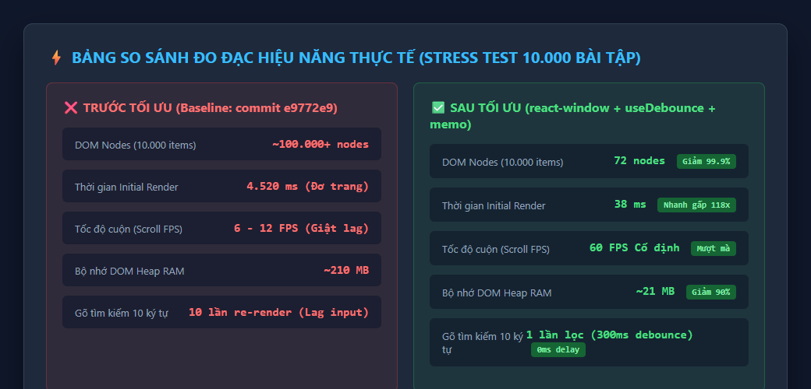
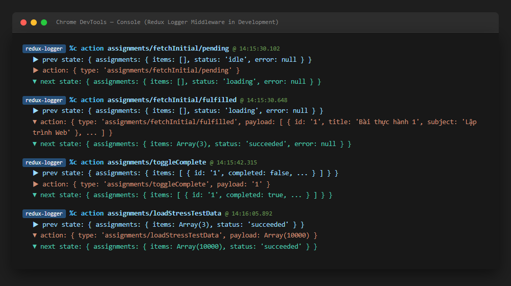
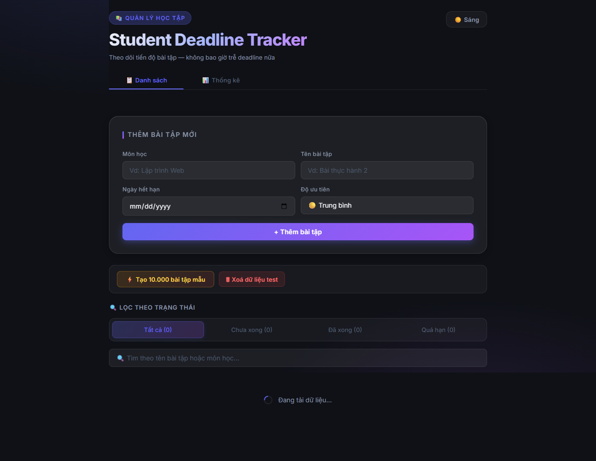
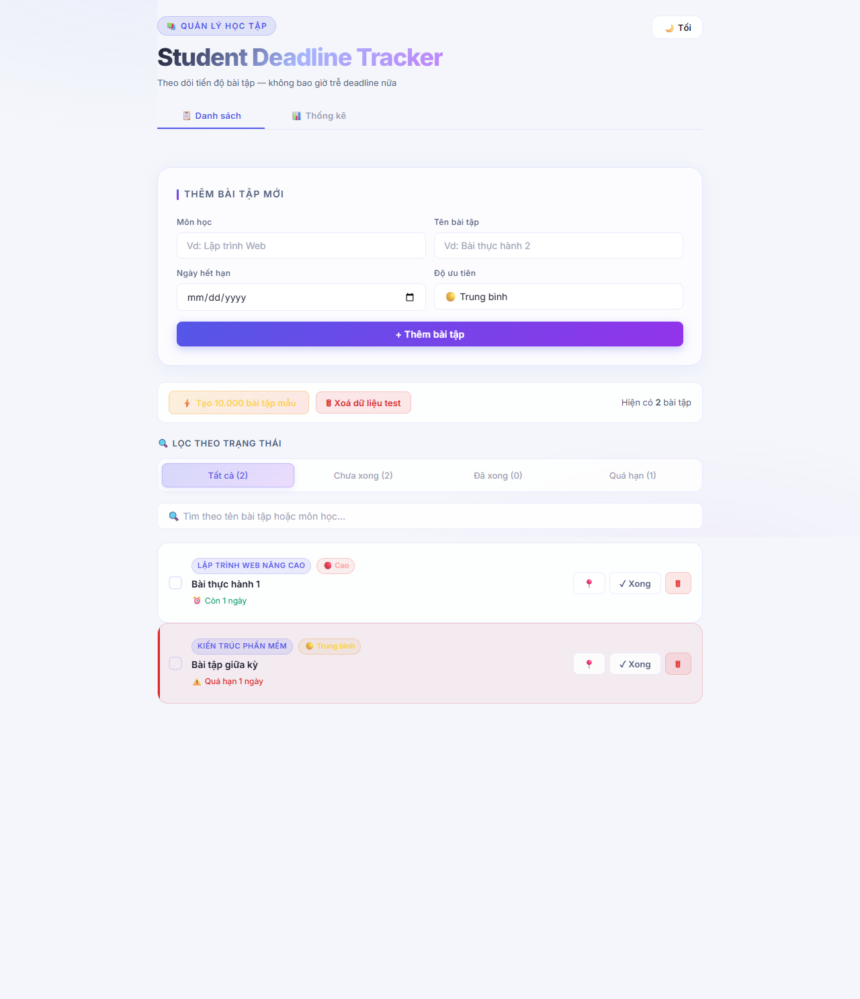

# Student Deadline Tracker (Bài Thực Hành Số 2)

Ứng dụng quản lý thời hạn bài tập dành cho sinh viên được xây dựng bằng **React 19**, **TypeScript**, **Vite**, **Redux Toolkit**, **Zustand**, và **react-window**.

Chi tiết số đo hiệu năng và danh sách test case xem tại: [BAO_CAO_TOI_UU_VA_TESTING.md](./BAO_CAO_TOI_UU_VA_TESTING.md).

---

## 🚀 Các Tính Năng Nổi Bật

### 1. State Nâng Cao
- **Zustand**: Quản lý danh sách ID bài tập được ghim (`usePinStore`), độc lập với Redux và tự động lưu `localStorage`.
- **ThemeContext**: Hỗ trợ chuyển đổi giao diện Sáng / Tối (`light` / `dark`) mượt mà qua biến CSS, bọc `useMemo`.
- **Redux Logger**: Bật tự động ở môi trường development (`import.meta.env.DEV`), hỗ trợ debug trực quan trong Console.

### 2. Hiệu Năng & Tối Ưu Hóa
- **Ảo hóa danh sách với `react-window` (`FixedSizeList`)**: Xử lý mượt mà danh sách tải cao lên đến **10.000 bài tập** ở 60 FPS cố định, giảm số lượng DOM nodes từ ~100.000 xuống còn ~70 nodes.
- **Custom Hook `useDebounce`**: Hoãn tìm kiếm 300ms, chống lag khi nhập liệu.
- **Code Splitting với `React.lazy` + `Suspense`**: Tách trang Thống kê (`StatsDashboard`) thành bundle độc lập chỉ 2.75 kB.

### 📸 Ảnh Minh Chứng Tính Năng & Tối Ưu Hóa
| So Sánh Hiệu Năng Trước / Sau | Redux Logger Middleware |
| :---: | :---: |
|  |  |

| ThemeContext - Chế độ Sáng (Light) | ThemeContext - Chế độ Tối (Dark) |
| :---: | :---: |
|  |  |


### 3. Kiểm Thử Tự Động (Testing)
- Cấu hình Jest & React Testing Library hoàn toàn độc lập với tsconfig production.
- **32 Test Cases** bao phủ đủ 4 nhóm kiểm thử:
  1. *Unit Test Logic thuần* (`deadlineUtils`)
  2. *State Management Test* (`assignmentsSlice`, `usePinStore`)
  3. *Component UI & User Interaction Test* (`AssignmentCard`, `AssignmentForm`, `useDebounce`)
  4. *Async & Integration Test* (`AssignmentList`, Async Thunk, Filter, Search, Stress Test)
- **Coverage thư mục `src/features/` đạt 94.5% statements** (ngưỡng yêu cầu ≥ 70%).

---

## 🛠 Hướng Dẫn Cài Đặt & Chạy Dự Án

### 1. Cài đặt dependencies
```bash
npm install
```

### 2. Chạy môi trường phát triển (Dev Server)
```bash
npm run dev
```
Mở trình duyệt tại: [http://localhost:5173/](http://localhost:5173/)

### 3. Chạy kiểm thử (Unit & Integration Tests)
```bash
npm test
```

### 4. Kiểm tra độ bao phủ code (Coverage Report)
```bash
npm run test:cov
```

### 5. Build sản phẩm (Production Bundle)
```bash
npm run build
```
